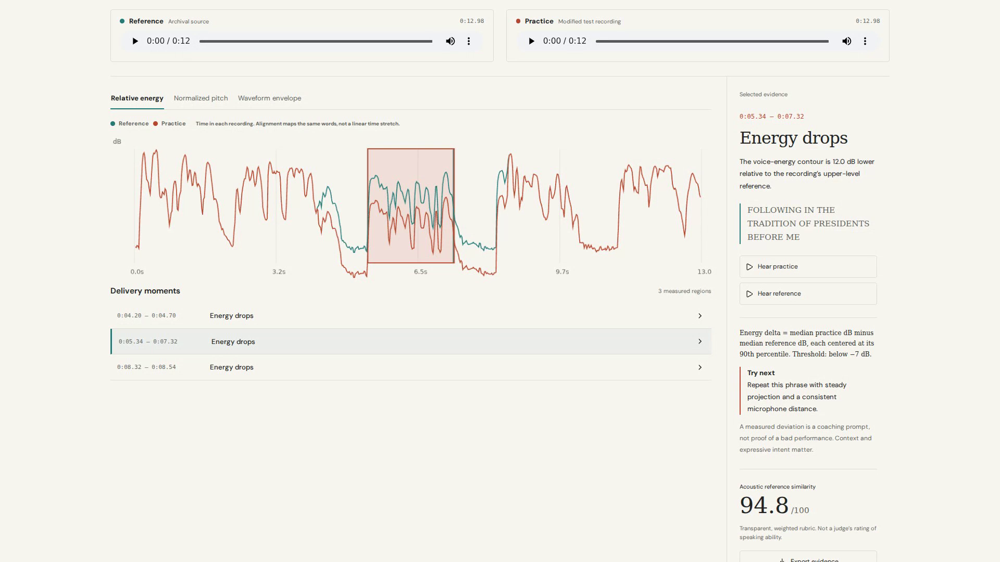

# CadenceLab

**Hear the difference. See the evidence.** An audio-and-text evidence workbench for student speakers and coaches, built for Multimodal AI Hackathon 2026, Track C.

CadenceLab compares two recordings of the same English transcript. A quantized Wav2Vec2 model provides acoustic token probabilities; transcript-constrained CTC forced alignment maps words to timestamps. Signal processing then locates measurable delivery changes, shows their equations, and lets a coach listen to the corresponding regions.

The similarity score describes a documented acoustic rubric. It does not grade talent, accents, rhetorical truth, health, or a person's worth.

[Open the live dashboard](https://cadencelab-mah2026.vercel.app/) · [Read the project story](https://devpost.com/software/cadencelab)

## Try it in five minutes

1. Open the dashboard and select **Try a labeled example**. No installation or account is required for the public examples.
2. Choose a **Reference** and **Controlled example**. The workbench loads the pair automatically.
3. Select a finding on the right. Compare **Relative energy**, **Normalized pitch** or **Waveform envelope**, then listen to the reference and practice phrase.
4. Click transcript words to seek through either recording. Export the JSON evidence to inspect the measurements outside the app.
5. Open **Dataset** for downloadable cases and inclusive results, or **Method** for the rubric, privacy boundary and limitations.

For your own rehearsal, choose **Compare recordings**, select a reference and practice audio file, paste the exact words spoken in both, then select **Run local comparison**. See [the usage guide](docs/USAGE.md) for input requirements, interpretation and troubleshooting.



## Run the dashboard

Use Node **22.12+** or **24.x** and npm. Clone the public repository first:

```sh
git clone https://github.com/adeelfalaksher900-creator/cadencelab-mah2026.git
cd cadencelab-mah2026
```

Then start the dashboard:

```sh
cd web
npm ci
npm run dev
```

Open the local URL printed by Vite. Labeled examples work immediately. Real uploads require a modern browser supporting WebAssembly and audio decoding. First use downloads a pinned 95 MB speech model; both recordings and the transcript remain in a browser worker. Use matching English transcripts and 3-60 second files, each below 20 MB. Spell out numbers. On low acoustic support, analysis refuses to invent a score.

```sh
npm run build
npm run preview
```

`vercel.json` deploys the static build with security headers. No server inference, account, database, telemetry, API key or paid model service is needed. The model host receives ordinary asset-download requests. The product makes no promise about compromised devices or browser extensions.

## Dataset and reproducibility

The custom dataset is checked in under `web/public/dataset/`: **90 paired cases, five reference excerpts, two speakers, three speeches**. Every case contains FLAC audio, its shared transcript, forced-alignment labels, frame features, transformation ground truth and detector results. `manifest.json` indexes the files; `references.json` records source intervals and attribution.

Changes cover three levels of local pacing, energy, pauses, white noise and pitch. Unmodified, global-gain and global-pitch controls test normalization. Synthetic modifications are explicitly labeled; they are not genuine student or historical performances.

Python 3.12 and FFmpeg with `atempo` and `rubberband`:

```sh
python -m venv .venv
. .venv/bin/activate
pip install -r requirements.txt
python tools/download_inputs.py
python src/build_dataset.py
python src/evaluate.py
```

To reanalyze the supplied corpus without recropping source recordings:

```sh
python src/refresh_analysis.py
python src/evaluate.py
python -m unittest discover -s tests -p 'test_*.py'
```

Model commit: `40a7d3243922b1fcbf660285036ecc7ef52667ea`; Apache 2.0 model family. See `docs/input-provenance.json` for hashes and `docs/DATASET.md` for rights and construction. Analysis uses four-second windows with half-second context. FFT and acoustic calculations use 40 ms frames and 20 ms hops. Fixed seeds make injected noise reproducible. Byte-level rebuilt audio can differ across FFmpeg/runtime versions; checked-in audio and hashes define this benchmark version.

## Evaluation

`web/public/evaluation.json` and the Dataset screen expose all case-level results, including misses and abstentions. A localized case requires same-type temporal IoU of at least 0.30 against its independently recorded injection interval. Thresholds were developed with this synthetic corpus, so these are development diagnostics, **not a held-out estimate of student accuracy**. Mild changes may remain below the rubric's explicit thresholds.

Historical English-speaking men are a narrow baseline. Real-student, accent, gender, language and recording-device validation remain necessary. Pitch tracking may make octave errors; heavy noise can defeat alignment. Source prestige is not a numerical ground-truth label for rhetorical quality.

## Contribute

CadenceLab is open source. Start with [CONTRIBUTING.md](CONTRIBUTING.md): it explains the development setup, useful contribution areas, validation and pull-request expectations. Documentation, accessibility, reproducibility and honest evaluation improvements are welcome. Do not publish private recordings or claim new accuracy without independent evidence.

Report reproducible bugs through [GitHub Issues](https://github.com/adeelfalaksher900-creator/cadencelab-mah2026/issues). For sensitive vulnerabilities, follow [SECURITY.md](SECURITY.md) rather than publishing an exploit or personal data.

## Project map

| Path | Purpose |
|---|---|
| `src/alignment.py` | Quantized acoustic inference and genuine CTC Viterbi alignment |
| `src/acoustics.py` | FFT, MFCC, RMS, pitch, normalization and temporal rubric |
| `src/build_dataset.py` | Deterministic paired corpus and independent injection labels |
| `src/evaluate.py` | Inclusive case and time-region diagnostics |
| `web/src/analysis.js` | Browser-local acoustic inference, alignment and comparison |
| `web/src/main.jsx` | Interactive workbench, dataset explorer and privacy explanation |
| `docs/` | Research, provenance, evaluation and verification |
| `video/` | HyperFrames composition and real-app recording workflow |

## AI and tool disclosure

OpenAI Codex assisted research, implementation, debugging, tests, documentation and production. Wav2Vec2 provides the actual AI acoustic model. Numerical scoring and recommendations are transparent signal-processing rules, not LLM-generated grades. The demo uses a disclosed stock synthetic voice; it does not clone either team member. Visual concepts are distinct from real application screenshots. Human participants must review, understand and be able to explain the submitted code.

Requested design/security/video skills were consulted where relevant. Shadcn registry installation was blocked by the environment; the shipped controls use Radix and the plots use Canvas. Cloudflare RLS, database isolation and live API pentesting do not apply to this static local-inference architecture. No paid scanner or generator was used.

## Team review

Proposed coordination roles: **Adeel Falak Sher** - product, interface and presentation; **Rauf Khalid** - dataset, acoustic evaluation and quality review. These are proposed roles for confirmation, not a claim that either person independently performed AI-assisted implementation. Only confirmed real team members should be added to Devpost.

Own application code is MIT licensed. Model, fonts, dependencies and public-domain source recordings retain their respective notices. See `LICENSE` and `docs/DATASET.md`.
